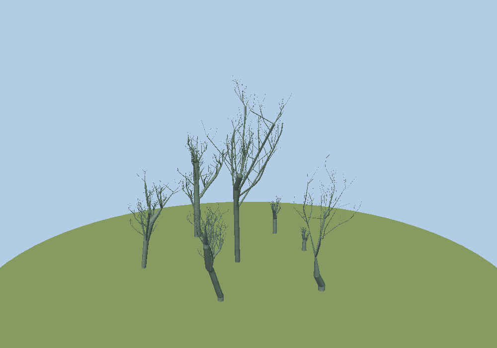

# Fractal trees

A 3D viewer for fractal tree models, written in C with OpenGL and GLUT. It started as a 2005–2006 doctoral course project ("Gráficos 3D", Universidad Autónoma de Madrid) and was originally built with Visual C++ on Windows. This repository is a cleaned-up port that builds and runs on Linux and macOS. It also includes a browser viewer, so you can look at the trees without compiling anything.



Each tree is a plain-text list of branches, and each branch is drawn as a tapered cylinder. The seven sample trees in `data/` are poplar (*Populus*) models with between 158 and 544 branches each. They're textured with poplar bark.

## Desktop viewer (C / OpenGL)

### Build

```sh
# Debian / Ubuntu
sudo apt install build-essential freeglut3-dev libglu1-mesa-dev
# Fedora
sudo dnf install gcc make freeglut-devel mesa-libGLU-devel
# Arch
sudo pacman -S base-devel freeglut glu

make
```

### Run

```sh
./fractal-trees                 # every tree in data/, laid out as a small forest
./fractal-trees -n 0            # just tree 0
./fractal-trees my_tree.fra     # your own file(s) or directories
./fractal-trees --help
```

| Input | Action |
|---|---|
| Left drag | Orbit |
| Right drag / mouse wheel | Zoom |
| Middle drag / arrow keys | Pan |
| `0` `1` `2` `3` | Lines / cylinders / cylinders + joints / bark texture |
| `+` `-` | More / less geometric detail |
| `n` or `Tab` | Cycle through each tree, then back to the whole forest |
| `a` `g` | Toggle axes / ground |
| `r` | Reset the view |
| `s` | Save `screenshot.ppm` |
| `q` or `Esc` | Quit |

`-o file.ppm` renders a single frame to a file and exits. That's how the images in `docs/` were made.


## Web viewer

`web/index.html` is a three.js version of the same viewer.

- **Without a server:** run `python3 tools/build_standalone.py`. It writes `dist/fractal-trees.html` with the trees and texture embedded, and you can open that file directly in a browser.
- **From the repository:** run `python3 -m http.server` in the repository root and open <http://localhost:8000/web/>. That page loads `data/*.fra`.

You can also drop your own `.fra` files onto the page.


## The `.fra` format

There's one branch per line, with whitespace-separated numbers. Lines that start with `#` or `//` are ignored.

```
# D1      D2        h          Fi         alfa       r0x       r0y         r0z
9.375000  9.093750  107.545624 13.200001  17.599998  0.000000  0.000000    0.000000
9.093750  9.422762  41.813736  15.972001  17.424000  7.425638  104.704155  23.408585
```

| Column | Meaning |
|---|---|
| `D1`, `D2` | Diameter at the base and at the tip |
| `h` | Branch length |
| `Fi` | Angle from the vertical (+Y), in degrees |
| `alfa` | Azimuth around the vertical, in degrees (0 = +Z, 90 = +X) |
| `r0x r0y r0z` | Centre of the branch base |

So a branch runs from `r0` to `r0 + h · (sin Fi · sin alfa, cos Fi, sin Fi · cos alfa)`.

## Repository layout

```
src/        C sources: main.c (CLI), viewer.c (OpenGL/GLUT), tree.c (.fra loader), bmp.c
data/       sample trees (tree0–6.fra) and bark texture (bark.bmp)
web/        browser viewer (three.js)
tools/      build_standalone.py: single-file web build
docs/       screenshots
```

The first commit contains the original 2006 Windows sources, unchanged except for conversion to UTF-8 and Unix line endings.

## Changes from the 2006 version

- Replaced the Windows-only headers (`windows.h`, `conio.h`, `glaux`) with portable freeglut, and fixed the case-sensitive file paths.
- BMP textures are now decoded properly. The original uploaded the raw file, including its 54-byte header, with blue and red swapped.
- Textures and geometry are built once and cached, not on every frame. The original also leaked a GLU quadric per branch per frame.
- Removed the hard limits of 1000 branches per tree and 50 trees.
- Fixed the projection and added an orbit camera that frames the scene automatically.
- Removed the unused skeleton/point-cloud viewer that the program grew out of.
- Translated the code and comments from Spanish to English.

## Credits

Original program by **Víctor Fernández-Carbajales Cañete** and **Javier Molina Vela**, 2005–2006. Port and cleanup by Javier Molina Vela, 2026.

## License

[MIT](LICENSE)
