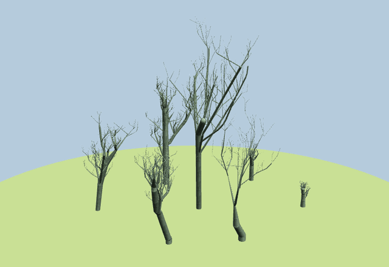
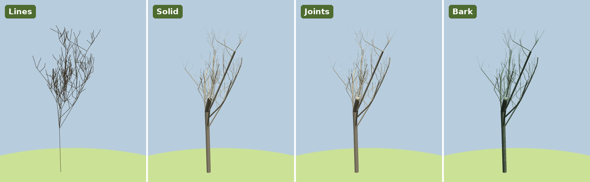
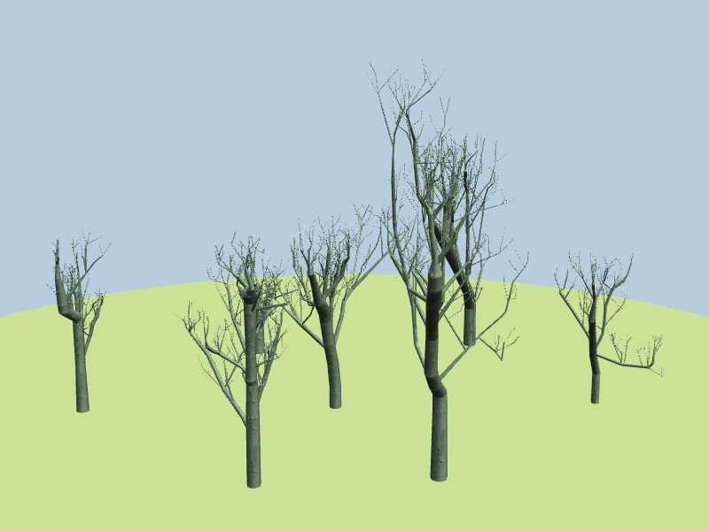
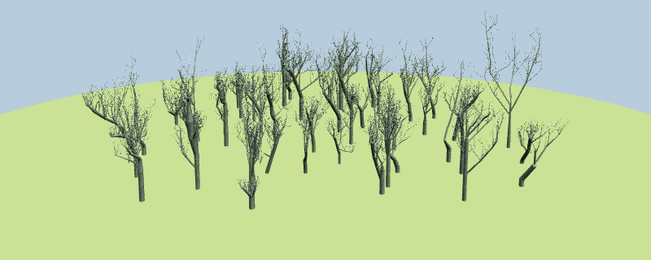

# Fractal trees

3D models of trees described as lists of branches, a generator that grows new ones from a handful of parameters, and a visualizer to explore them. It started as a 2004–2006 doctoral course project ("Gráficos 3D", Universidad Autónoma de Madrid), originally built with Visual C++ on Windows. This repository is a cleaned-up, portable version of it.

[](https://javimol.github.io/fractal-trees/visualizer/standalone/fractal-trees.html)

**[▶ Open the interactive viewer](https://javimol.github.io/fractal-trees/visualizer/standalone/fractal-trees.html)** in your browser: orbit, zoom, switch render modes and look at each tree. Nothing to install.

## Explore the forest four ways

The viewer, in the browser or on the desktop, draws every tree in four modes. Switch between them at any time with the **Lines / Solid / Joints / Bark** buttons, or the `0`–`3` keys on the desktop:



| Mode | What you see | Good for |
|---|---|---|
| **Lines** | Each branch as a single line | Reading the branching structure, the skeleton the generator builds |
| **Solid** | Tapered, shaded cylinders | The volume of trunk and branches |
| **Joints** | Cylinders plus a sphere at every joint | Smooth bends where crooked segments meet |
| **Bark** | Joints with a bark texture | The finished look |

Drag to orbit, scroll to zoom and right-drag to pan. The list on the left switches between the whole forest and each tree on its own, and the **Detail** slider trades smoothness for speed. Try it with the [original seven poplars](https://javimol.github.io/fractal-trees/visualizer/standalone/fractal-trees.html) or the [50-tree forest](https://javimol.github.io/fractal-trees/visualizer/standalone/big-forest.html).

## Contents

```
data/chopos/             seven poplar (chopo) models, Arbol0–6.fra, plus a bark texture
data/big_forest_chopos/  50 poplars grown with the generator, tree0–49.fra, plus the same texture
tree_generator/          command-line generator that grows new .fra trees (C, no dependencies)
visualizer/              desktop viewer (C, OpenGL, GLUT) and web viewer (three.js)
docs/                    screenshots and animations
```

To see the trees straight away:

```sh
cd visualizer
make            # see visualizer/README.md for dependencies
./fractal-trees
```

Or, without compiling or running anything, open the [interactive viewer](https://javimol.github.io/fractal-trees/visualizer/standalone/fractal-trees.html). It's [visualizer/standalone/fractal-trees.html](visualizer/standalone/fractal-trees.html), a single file with all seven trees embedded, served by GitHub Pages. You can also download it and open it locally (it needs an internet connection to load three.js). [visualizer/README.md](visualizer/README.md#web-viewer) has more on the web viewer.

To grow a forest of your own and look at it:

```sh
cd tree_generator
make
./tree-generator -n 7 -o forest
../visualizer/fractal-trees -t ../data/chopos/bark.bmp forest
```

## The generator

[tree_generator/](tree_generator/) grows a tree step by step: each segment can continue its axis with a shorter, thinner one and sprout branches around it inside a cone, and any segment can come out crooked. About twenty parameters (height, growth rate, age, branching cone, frondage, crookedness, variability…) control the shape, and they're read from a simple `key = value` file. The defaults are the ones that made `data/chopos/`, so its trees look like the originals, as in the picture below. [tree_generator/README.md](tree_generator/README.md) describes every parameter and the algorithm.



### A bigger forest

[data/big_forest_chopos/](data/big_forest_chopos/) holds 50 poplars (21,749 branches) grown with the default parameters:

```sh
./tree-generator -s 2026 -n 50 -o ../data/big_forest_chopos
```

**[▶ Explore it in your browser](https://javimol.github.io/fractal-trees/visualizer/standalone/big-forest.html)** ([visualizer/standalone/big-forest.html](visualizer/standalone/big-forest.html)). With the desktop viewer, run `./fractal-trees ../data/big_forest_chopos`.

[](https://javimol.github.io/fractal-trees/visualizer/standalone/big-forest.html)

## The tree models

Each `.fra` file describes one tree as plain text, one branch per line. Each branch is a tapered cylinder:

```
# D1      D2        h          Fi         alfa       r0x       r0y         r0z
9.375000  9.093750  107.545624 13.200001  17.599998  0.000000  0.000000    0.000000
9.093750  9.422762  41.813736  15.972001  17.424000  7.425638  104.704155  23.408585
```

| Column | Meaning |
|---|---|
| `D1`, `D2` | Diameter at the base and at the tip |
| `h` | Branch length |
| `Fi` | Angle from the vertical (+Y), in degrees |
| `alfa` | Azimuth around the vertical, in degrees (0 = +Z, 90 = +X) |
| `r0x r0y r0z` | Centre of the branch base |

So a branch runs from `r0` to `r0 + h · (sin Fi · sin alfa, cos Fi, sin Fi · cos alfa)`. Values are whitespace-separated, lines starting with `#` or `//` are comments, and Windows (CRLF) line endings are fine.

The files in `data/chopos/` are the original 2006 files, unchanged. They were made by the 2006 version of the generator and range from 158 to 544 branches per tree. Those in `data/big_forest_chopos/` come from the rewritten generator and range from 71 to 759.

## History

The first commit holds the original 2006 Windows sources of the visualizer, unchanged except for conversion to UTF-8 and Unix line endings. Later commits port it to Linux and then clean it up; [visualizer/README.md](visualizer/README.md#changes-from-the-2006-version) lists what changed.

The generator was a separate Windows program (MFC, Visual C++) by Víctor Fernández-Carbajales Cañete. `tree_generator/` is a rewrite of it as a portable command-line tool that keeps the same algorithm; [tree_generator/README.md](tree_generator/README.md#changes-from-the-2006-version) lists what changed.

## Credits

Original visualizer by **Víctor Fernández-Carbajales Cañete** and **Javier Molina Vela**, 2004–2006; original generator by **Víctor Fernández-Carbajales Cañete**, 2006. Port and cleanup by Javier Molina Vela, 2026.

## License

[MIT](LICENSE)
