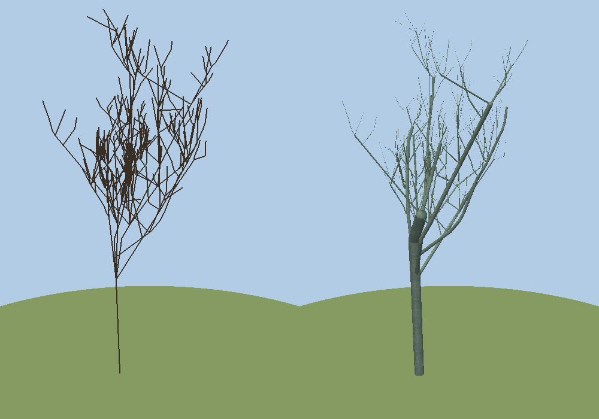
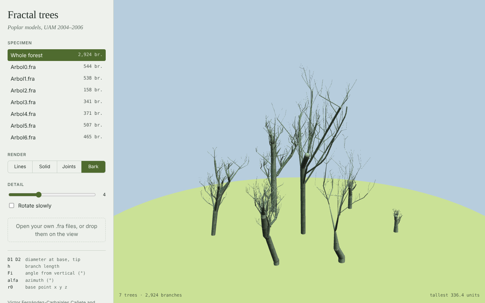

# Visualizer

Interactive 3D viewer for the `.fra` tree models in this repository. It comes in two versions that share the same file format and look:

- a **desktop viewer** in C with OpenGL and GLUT (`src/`), the descendant of the 2006 program;
- a **web viewer** using three.js (`web/`), which runs in any modern browser.

## Desktop viewer

### Build

Run these in this folder (`visualizer/`):

```sh
# Debian / Ubuntu
sudo apt install build-essential freeglut3-dev libglu1-mesa-dev
# Fedora
sudo dnf install gcc make freeglut-devel mesa-libGLU-devel
# Arch
sudo pacman -S base-devel freeglut glu

make
```

It's tested on Linux. macOS should also work, since the Makefile links the system GLUT framework there, but it hasn't been tried.

### Run

```sh
./fractal-trees                 # every tree in ../data/chopos/, laid out as a small forest
./fractal-trees -n 0            # just tree 0
./fractal-trees ~/some/folder   # every *.fra in a folder, e.g. an original 2006 tree set
./fractal-trees my_tree.fra     # or individual files
./fractal-trees --help
```

Without arguments, the program finds `data/chopos/` from where the executable is, so it also works when started from another directory.

When given a folder, the viewer loads its `.fra` files in natural order (`Arbol2` before `Arbol10`). It uses `bark.bmp` as the bark texture, or the first `.bmp` in the folder if there's no `bark.bmp`, so a 2006 tree folder works as-is. Textures must be uncompressed 24-bit BMP files.

| Input | Action |
|---|---|
| Left drag | Orbit |
| Right drag / mouse wheel | Zoom |
| Middle drag / arrow keys | Pan |
| `0` `1` `2` `3` | Lines / cylinders / cylinders + joints / bark texture |
| `+` `-` | More / less geometric detail |
| `n` or `Tab` | Cycle through each tree, then back to the whole forest |
| `a` `g` | Toggle axes / ground |
| `r` | Reset the view |
| `s` | Save `screenshot.ppm` |
| `q` or `Esc` | Quit |

`-o file.ppm` renders a single frame to a file and exits. That's how the images in `../docs/` were made.



### Source layout

```
src/main.c     command line, finding and loading tree folders
src/tree.c/h   .fra parser (Tree, Branch)
src/bmp.c/h    minimal 24-bit BMP loader
src/viewer.c/h OpenGL/GLUT rendering, camera and controls
```

## Web viewer

`web/index.html` is a three.js version of the same viewer, with the same render modes. You can also drop your own `.fra` files onto it.

- **Without a server:** open [standalone/fractal-trees.html](standalone/fractal-trees.html) directly in a browser (download it, or double-click it in a clone). It's a single file with the trees and texture embedded. It loads three.js from a CDN, so it needs an internet connection. After changing `web/index.html` or the data, rebuild it with `python3 tools/build_standalone.py`.
- **From the repository:** run `python3 -m http.server` in the repository root (the folder above this one) and open <http://localhost:8000/visualizer/web/>. That page loads `data/chopos/`.



## Changes from the 2006 version

- Replaced the Windows-only headers (`windows.h`, `conio.h`, `glaux`) with portable freeglut, and fixed the case-sensitive file paths.
- BMP textures are now decoded properly. The original uploaded the raw file, including its 54-byte header, with blue and red swapped.
- Textures and geometry are built once and cached, not on every frame. The original also leaked a GLU quadric per branch per frame.
- Removed the hard limits of 1000 branches per tree and 50 trees.
- Fixed the projection and added an orbit camera that frames the scene automatically.
- Removed the unused skeleton/point-cloud viewer that the program grew out of.
- Translated the code and comments from Spanish to English.
